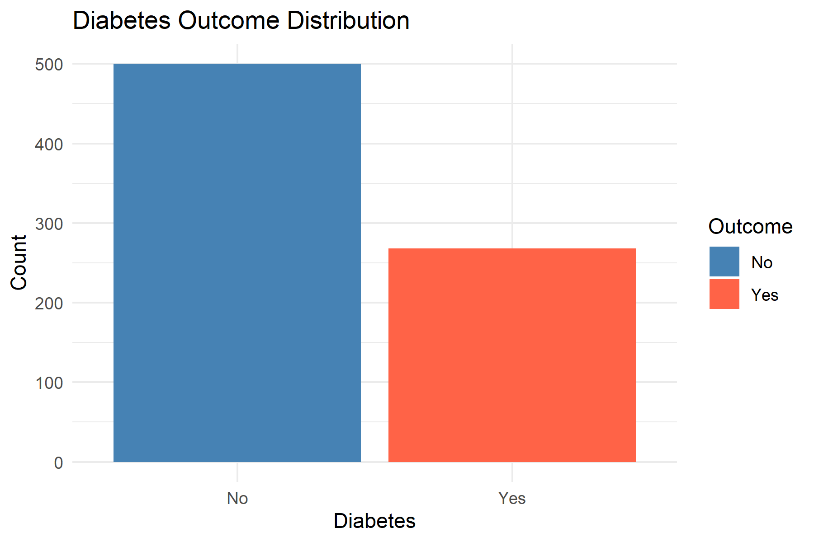
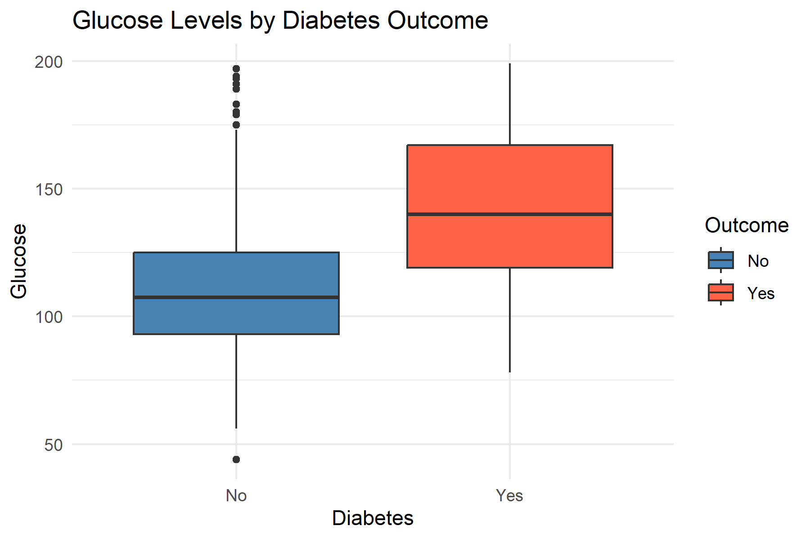
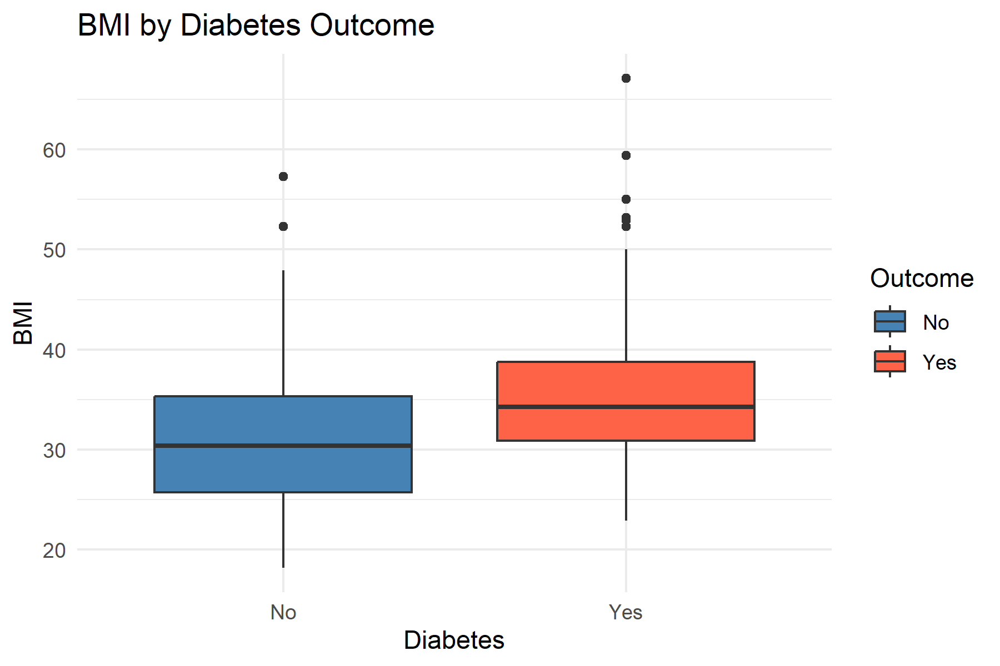
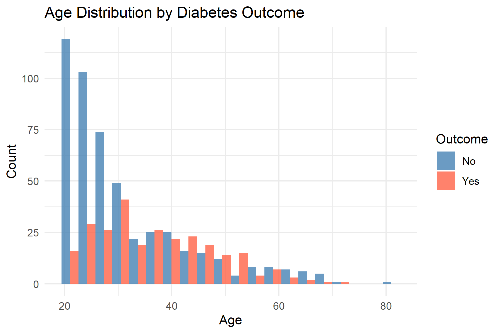
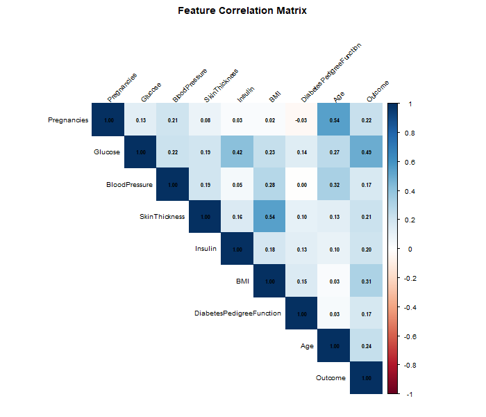
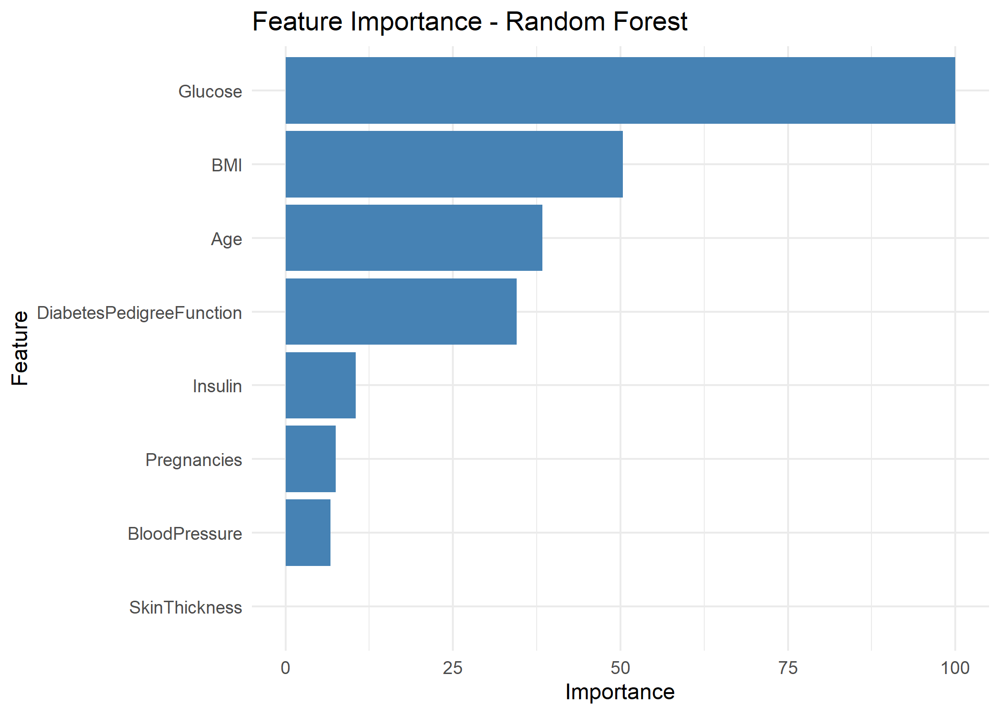

# Diabetes Prediction Using Machine Learning in R

## 1. Abstract

Diabetes is a chronic health condition that affects how the human body processes blood glucose. Early identification of individuals who may be at risk of diabetes is important because timely medical attention and lifestyle changes can help reduce the risk of serious complications. Machine learning techniques provide opportunities to analyse medical datasets and identify patterns that may support diabetes risk prediction.

This project focuses on developing a machine learning-based diabetes prediction system using the Pima Indians Diabetes Dataset. The project is implemented using the R programming language and applies data preprocessing, exploratory data analysis (EDA), data visualization, model development, and performance evaluation techniques.

Two classification algorithms are implemented: Logistic Regression and Random Forest. Logistic Regression is used as a baseline classification model, while Random Forest is used to identify more complex relationships between the input features and diabetes outcomes.

The dataset contains 768 patient records and eight predictor variables, including glucose level, blood pressure, body mass index (BMI), age, and number of pregnancies. The target variable, Outcome, indicates whether a patient has diabetes.

The project follows an 80:20 stratified training and testing split and uses five-fold cross-validation during model training. Model performance is evaluated using accuracy, sensitivity, specificity, F1-score, and the Area Under the Receiver Operating Characteristic Curve (AUC-ROC).

The main objective is to demonstrate how machine learning can be applied to healthcare-related classification problems and investigate which patient characteristics contribute most to diabetes prediction.

## 2. Introduction

Diabetes is one of the major health challenges worldwide. It occurs when the body cannot produce sufficient insulin or cannot effectively use the insulin it produces. This results in elevated blood glucose levels, which may lead to long-term health complications.

Traditional diabetes identification involves medical examinations, laboratory tests, and professional assessment. However, machine learning offers additional analytical approaches by examining historical patient data and identifying relationships between medical characteristics and disease outcomes.

Machine learning is a branch of artificial intelligence that enables computer systems to learn patterns from data and make predictions without being explicitly programmed for every possible situation.

In healthcare applications, classification algorithms can be used to predict whether a patient belongs to a particular disease category based on available medical information.

This project investigates the application of machine learning techniques to diabetes prediction using the Pima Indians Diabetes Dataset.

The R programming language is selected because it provides useful statistical analysis, visualization, and machine learning libraries. Packages such as `caret`, `randomForest`, `ggplot2`, and `dplyr` support different stages of the machine learning workflow.

Two machine learning algorithms are developed and compared:

- Logistic Regression
- Random Forest

The project also examines relationships between patient characteristics and diabetes outcomes through exploratory data analysis and feature importance analysis.

## 3. Problem Statement

Early identification of diabetes risk is an important healthcare challenge. Medical datasets contain several patient characteristics that may be associated with diabetes, but identifying meaningful patterns manually can be difficult.

The main problem addressed in this project is:

**How can machine learning algorithms use patient medical information to predict whether an individual is likely to have diabetes?**

The project attempts to solve this problem by analysing historical patient records, preprocessing the data, training classification models, and evaluating their predictive performance.

The system uses eight input features to predict one binary output:

- 0 – No Diabetes
- 1 – Diabetes

This project is intended for academic and experimental purposes rather than replacing professional medical diagnosis.

## 4. Project Objectives

The main objectives of this project are:

1. To understand and analyse the Pima Indians Diabetes Dataset.
2. To identify missing and invalid values in the dataset.
3. To perform data cleaning and preprocessing using R.
4. To conduct exploratory data analysis to understand the distribution of patient characteristics.
5. To visualize relationships between medical features and diabetes outcomes.
6. To develop Logistic Regression and Random Forest classification models.
7. To apply cross-validation to improve model reliability.
8. To evaluate the models using multiple classification performance metrics.
9. To identify important features that influence diabetes predictions.
10. To compare the performance of different machine learning algorithms.

## 5. Dataset Description

The dataset used in this project is the Pima Indians Diabetes Dataset, obtained from Kaggle.

**Dataset source:** [Pima Indians Diabetes Database – Kaggle](https://www.kaggle.com/datasets/uciml/pima-indians-diabetes-database)

The dataset contains 768 patient records. Each record includes medical information about an individual and an associated diabetes outcome.

There are eight independent variables and one dependent variable.

### 5.1 Dataset Features

| Feature | Description |
|---|---|
| Pregnancies | Number of times the patient has been pregnant |
| Glucose | Plasma glucose concentration |
| BloodPressure | Diastolic blood pressure measured in mm Hg |
| SkinThickness | Triceps skin fold thickness in mm |
| Insulin | Two-hour serum insulin level |
| BMI | Body Mass Index |
| DiabetesPedigreeFunction | A score representing diabetes-related family history |
| Age | Age of the patient in years |
| Outcome | Diabetes classification (0 or 1) |

### 5.2 Target Variable

The target variable is `Outcome`.

It contains two possible classes:

- `0`: The patient does not have diabetes according to the dataset.
- `1`: The patient has diabetes according to the dataset.

This makes the problem a binary classification task.

## 6. Methodology

The project follows a structured machine learning workflow consisting of data importing, preprocessing, exploratory analysis, model training, and evaluation.

### 6.1 Data Importing

The dataset is imported into the R environment using CSV file-reading functionality.

The dataset is stored in the `data/` directory as `diabetes.csv`.

The initial analysis includes:

- Checking the dataset dimensions.
- Examining column names and data types.
- Displaying the first few records.
- Identifying missing values.
- Generating summary statistics.

These steps help understand the dataset before applying machine learning algorithms.

### 6.2 Data Cleaning and Preprocessing

Data preprocessing is an important stage because the quality of input data directly affects machine learning performance.

In the Pima Indians Diabetes Dataset, certain medical variables contain zero values that may represent missing or invalid measurements.

For example:

- Glucose = 0
- BloodPressure = 0
- SkinThickness = 0
- Insulin = 0
- BMI = 0

These values are treated as invalid measurements rather than actual medical observations.

Therefore, the zero values in the relevant medical features are replaced with missing values (`NA`).

The zero values in `Pregnancies` and `Outcome` are retained because they represent valid information.

**Median Imputation**

After identifying invalid values, missing observations are handled using median imputation.

The median is calculated for each affected feature and used to replace its missing values.

Median imputation is selected because it is less sensitive to extreme values than mean imputation.

For a reliable evaluation, imputation values should be calculated using the training dataset and then applied to the testing dataset. This helps prevent data leakage.

### 6.3 Exploratory Data Analysis (EDA)

Exploratory Data Analysis is performed to understand the characteristics of the dataset and identify patterns that may be useful for diabetes prediction.

The analysis includes:

- Overall dataset summary.
- Distribution of diabetes and non-diabetes cases.
- Comparison of glucose levels between outcome groups.
- Comparison of BMI values between outcome groups.
- Distribution of patient ages.
- Correlation analysis between numerical variables.

EDA helps identify potentially important variables and understand how patient characteristics differ between the two outcome classes.

### 6.4 Data Visualization

Data visualization is used to present important patterns in an understandable graphical format.

The project generates the following visualizations.

#### 6.4.1 Outcome Distribution



**Figure 1: Distribution of Diabetes Outcomes**

This bar chart shows the number of patients belonging to each outcome category.

It helps identify whether the dataset contains balanced or imbalanced classes. The distribution is important because class imbalance can influence classification performance.

#### 6.4.2 Glucose Level Comparison



**Figure 2: Glucose Levels by Diabetes Outcome**

This boxplot compares glucose measurements between patients with and without diabetes.

Glucose is an important variable to investigate because differences in blood glucose levels may be associated with diabetes status.

#### 6.4.3 BMI Comparison



**Figure 3: BMI Distribution by Diabetes Outcome**

This visualization compares Body Mass Index values between the two outcome groups.

It helps examine whether BMI distributions differ between patients with and without diabetes.

#### 6.4.4 Age Distribution



**Figure 4: Distribution of Patient Ages**

The age distribution visualization provides information about the age characteristics of the patients included in the dataset.

Age is investigated because it may contribute to differences in diabetes risk.

#### 6.4.5 Correlation Heatmap



**Figure 5: Correlation Heatmap of Dataset Features**

The correlation heatmap represents the relationships between numerical variables.

Correlation values range from -1 to +1.

- Positive correlation indicates that two variables tend to increase together.
- Negative correlation indicates that one variable tends to decrease when the other increases.
- A value close to zero indicates a weak linear relationship.

This visualization helps identify variables that have stronger linear relationships with the target variable.

However, correlation does not necessarily imply causation.

## 7. Machine Learning Models

Two supervised machine learning classification algorithms are implemented in this project.

### 7.1 Logistic Regression

Logistic Regression is a statistical classification algorithm commonly used for binary classification problems.

Unlike Linear Regression, Logistic Regression predicts the probability of an observation belonging to a particular class.

It uses the logistic (sigmoid) function to convert a linear combination of input features into a probability between 0 and 1.

The general sigmoid function is:

P(Y = 1) = 1 / (1 + e^(-z))

Where:

- P(Y = 1) represents the probability of diabetes.
- e represents the exponential constant.
- z represents the weighted combination of input features.

A classification threshold is then used to assign the predicted class.

Logistic Regression is selected as the baseline model because it is relatively simple, interpretable, and suitable for binary classification.

### 7.2 Random Forest

Random Forest is an ensemble machine learning algorithm that combines multiple decision trees to produce a final prediction.

Each decision tree is trained using a different sample of the training data and a random selection of features.

For classification, the final prediction is generally determined through majority voting among the individual decision trees.

The main advantages of Random Forest include:

- Ability to capture nonlinear relationships.
- Handling multiple input features.
- Reduced dependence on a single decision tree.
- Support for feature importance analysis.
- Generally good performance on structured datasets.

Random Forest is selected to investigate whether an ensemble-based approach can achieve better predictive performance than Logistic Regression.

## 8. Model Training and Validation

Before model training, the dataset is divided into training and testing subsets.

### 8.1 Train-Test Split

An 80:20 split is used:

- 80% of the dataset is allocated for training.
- 20% of the dataset is allocated for testing.

Stratified sampling is applied to maintain approximately the same proportion of diabetes and non-diabetes cases in both subsets.

The training dataset is used to build the machine learning models, while the testing dataset is reserved for final performance evaluation.

### 8.2 Five-Fold Cross-Validation

Five-fold cross-validation is used during model training.

The training dataset is divided into five approximately equal subsets.

The model is trained five times:

1. Four subsets are used for training.
2. The remaining subset is used for validation.
3. The process is repeated until each subset has been used for validation.

The performance obtained across the five iterations is used to assess model stability.

Cross-validation helps reduce dependence on a single validation split. However, it does not completely eliminate overfitting.

## 9. Model Evaluation

Model performance is evaluated using multiple classification metrics.

Accuracy alone is not sufficient for healthcare-related classification problems because incorrect predictions may have different consequences.

Therefore, this project considers the following evaluation metrics.

### 9.1 Accuracy

Accuracy measures the proportion of correctly classified observations.

Accuracy = (TP + TN) / (TP + TN + FP + FN)

### 9.2 Sensitivity

Sensitivity measures the proportion of actual diabetes cases correctly identified by the model.

Sensitivity = TP / (TP + FN)

Higher sensitivity means the model identifies more patients who have diabetes.

### 9.3 Specificity

Specificity measures the proportion of actual non-diabetes cases correctly identified.

Specificity = TN / (TN + FP)

### 9.4 F1-Score

The F1-score is the harmonic mean of precision and sensitivity.

F1 = 2 × (Precision × Recall) / (Precision + Recall)

It provides a combined measure of precision and recall.

### 9.5 AUC-ROC

The Area Under the Receiver Operating Characteristic Curve measures the model's ability to distinguish between the two outcome classes across different classification thresholds.

An AUC value closer to 1 indicates better class discrimination, while a value around 0.5 indicates performance similar to random classification.

These metrics provide a broader understanding of the classification models than accuracy alone.

## 10. Results and Discussion

The project investigates two classification algorithms: Logistic Regression and Random Forest.

The models are evaluated using the same training and testing methodology to support a fair comparison.

The following observations are important when analysing the results.

**Glucose:** Glucose is expected to be an important predictive feature because blood glucose measurements are closely related to diabetes assessment.

**BMI:** BMI is another important feature to investigate because body composition and obesity-related factors can be associated with diabetes risk.

**Age:** Age may also contribute to the prediction process because diabetes risk can vary across different age groups.

**Model Comparison:** Logistic Regression provides a relatively interpretable baseline, while Random Forest can capture more complex relationships between the input variables.

Random Forest may achieve higher predictive performance, but the final conclusion should be based on the actual testing metrics generated by the R implementation.

The project uses approximately 77–80% accuracy as an expected performance reference for Random Forest on this dataset. This is not a guaranteed result, and actual performance depends on preprocessing, random splitting, model parameters, and evaluation settings.

The comparison should consider sensitivity and specificity in addition to accuracy, especially because missing an actual diabetes case may be more serious than incorrectly identifying a non-diabetes case.

### 10.1 Feature Importance Analysis



**Figure 6: Random Forest Feature Importance**

Feature importance analysis is performed using the Random Forest model.

It provides an indication of which input variables contribute most to the model's predictive decisions.

Glucose and BMI are expected to be among the important predictors, although the actual ranking must be determined from the generated feature importance plot.

Feature importance should not be interpreted as proof that a particular variable causes diabetes. It only describes how the trained model uses the available features.

## 11. Limitations

Although the project demonstrates the application of machine learning to diabetes prediction, several limitations should be considered.

**1. Dataset Size**

The dataset contains only 768 records. This relatively small sample may limit the generalization ability of the developed models.

**2. Dataset Population**

The dataset represents a specific population. Therefore, predictions from these models may not generalize to all populations.

**3. Missing and Invalid Values**

Several medical variables contain zero values that are treated as missing measurements. Median imputation is a practical solution, but it may not fully represent the original medical information.

**4. Model Limitations**

Logistic Regression assumes a particular relationship between input variables and the log-odds of the outcome. Random Forest can capture nonlinear relationships but may be less straightforward to interpret.

**5. Evaluation Limitations**

Performance metrics obtained from one train-test split may vary depending on the selected observations and random seed.

**6. Clinical Reliability**

The models are developed for academic purposes and have not been clinically validated. They should not be used to make medical decisions or replace professional healthcare advice.

## 12. Conclusion

This project demonstrates how machine learning techniques can be applied to a healthcare-related classification problem using the Pima Indians Diabetes Dataset.

The complete workflow includes data importing, data cleaning, missing-value handling, exploratory data analysis, data visualization, model development, and performance evaluation.

Logistic Regression and Random Forest are implemented to predict diabetes outcomes based on eight patient characteristics.

The project also demonstrates the importance of data preprocessing, stratified sampling, cross-validation, and multiple evaluation metrics when developing classification models.

The visual analysis provides an opportunity to investigate relationships between diabetes outcomes and important medical features such as glucose, BMI, and age.

Furthermore, Random Forest feature importance analysis helps identify which variables contribute to the model's predictions.

Overall, this project provides practical experience in applying statistical analysis and machine learning techniques using R. It also establishes a foundation for future improvements, including hyperparameter tuning, additional classification algorithms, larger datasets, and more advanced model interpretation techniques.

The developed system is an academic demonstration and is not intended for clinical diagnosis.

## 13. Future Improvements

Several improvements can be considered in future versions of this project:

- Implement additional algorithms such as Support Vector Machines and Gradient Boosting.
- Perform hyperparameter optimization to improve model performance.
- Apply more advanced feature selection techniques.
- Investigate different missing-value imputation methods.
- Use larger and more diverse healthcare datasets.
- Apply explainable AI techniques such as SHAP to understand individual predictions.
- Develop a simple user interface using Shiny in R.
- Conduct external validation using an independent dataset.

These improvements could help develop a more reliable and understandable diabetes risk prediction system.

## 14. Technologies and Tools

The following technologies and libraries are used in the project:

| Technology | Purpose |
|---|---|
| R | Programming language |
| RStudio | Development environment |
| caret | Model training and validation |
| randomForest | Random Forest classification |
| ggplot2 | Data visualization |
| corrplot | Correlation heatmap |
| dplyr | Data manipulation |
| e1071 | Supporting machine learning functionality |

## 15. Project Structure

The project is organized into separate directories to maintain a clear and manageable structure.

```text
Diabetes-prediction/
│
├── data/
│   └── diabetes.csv
│
├── code/
│   ├── 01_import_check.R
│   └── 02_model.R
│
├── figures/
│   ├── 01_outcome_distribution.png
│   ├── 02_glucose_boxplot.png
│   ├── 03_bmi_boxplot.png
│   ├── 04_age_distribution.png
│   ├── 05_correlation_heatmap.png
│   └── 06_feature_importance.png
│
├── Diabetes-prediction.Rproj
└── README.md
```

The `data/` directory contains the dataset, while the `code/` directory contains the R scripts used for data analysis and model development.

The `figures/` directory stores the visualizations generated during the project.

## 16. How to Run the Project

### Requirements

- R version 4.0 or higher.
- RStudio.
- Required R packages.

### Step 1: Clone the Repository

```bash
git clone YOUR_GITHUB_REPOSITORY_URL
```

### Step 2: Open the Project

Open `Diabetes-prediction.Rproj` using RStudio.

### Step 3: Install Required Packages

Run the following command in the R console:

```r
install.packages(c(
  "caret",
  "randomForest",
  "ggplot2",
  "corrplot",
  "dplyr",
  "e1071"
))
```

### Step 4: Run the Project

Run the following script to execute the complete machine learning pipeline:

```r
source("code/02_model.R")
```

The `01_import_check.R` script contains the initial data importing, cleaning, exploratory analysis, and visualization steps.

The `02_model.R` script contains the model development and evaluation pipeline.

Make sure the dataset and required project directories are available before execution.

## 17. References

1. Kaggle. (n.d.). *Pima Indians Diabetes Database*. Available at: https://www.kaggle.com/datasets/uciml/pima-indians-diabetes-database

2. Breiman, L. (2001). Random Forests. *Machine Learning*, 45, 5–32.

3. Hosmer, D. W., Lemeshow, S., & Sturdivant, R. X. (2013). *Applied Logistic Regression* (3rd ed.). Wiley.

4. Kuhn, M. (2008). Building Predictive Models in R Using the caret Package. *Journal of Statistical Software*, 28(5).

5. R Core Team. (n.d.). *R: A Language and Environment for Statistical Computing*. https://www.r-project.org/

---

**Project Type:** Academic Machine Learning Project  
**Programming Language:** R  
**Dataset:** Pima Indians Diabetes Dataset  
**Models:** Logistic Regression and Random Forest  
**Purpose:** Educational and research purposes only. Not intended for clinical diagnosis.